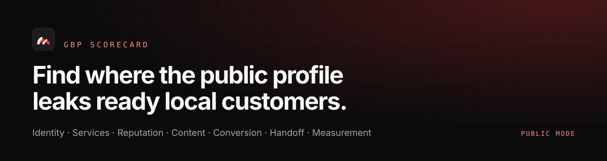
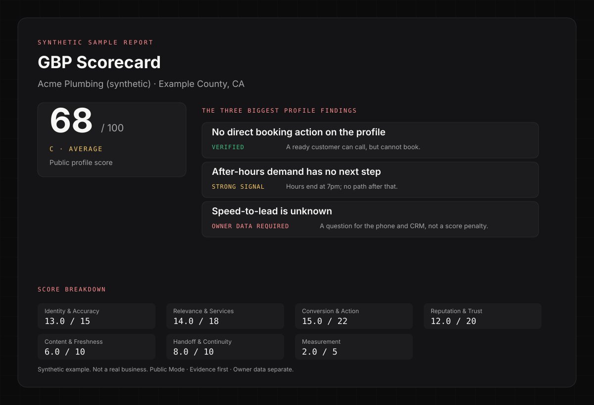

# GBP Scorecard

**Find where a Google Business Profile may be leaking ready local customers.**

[](https://github.com/thatguynef/gbp-scorecard/actions/workflows/ci.yml)
[](LICENSE)
[](CHANGELOG.md)
[](package.json)
[](package.json)

> [!NOTE]
> **Built for local home-service businesses** — plumbing, HVAC, roofing, electrical, pest control, garage door, landscaping, restoration, cleaning, and similar trades. It is also for the marketers, agencies, and analysts who serve them. Read the [audience guide](docs/audience.md).

| At a glance | |
|---|---|
| **The question** | Does the observable Google Business Profile create trust and enable action? |
| **The output** | A 0–100 profile score, a contractor-facing one-pager, a full evidence report, and the owner-data questions public data cannot answer |
| **The rule** | Only what the public profile can prove is scored. Everything else is marked **owner data required**. |
| **What it is not** | A completeness grader, a SaaS dashboard, a GBP management product, or a guarantee of revenue lift |



*Synthetic example — not a real business. Read the [one-page report](examples/acme-plumbing/one-page.md) or the [full audit](examples/acme-plumbing/full-report.md).*

## Who it's for

**Local home-service businesses** — the trades people call when something at home is broken, dirty, unsafe, or overdue. If customers find you in Google Search or Maps, call, request an estimate, or book, this framework was written for you.

It is also for the people who run the marketing: in-house marketers, local agencies, consultants, and analysts who need a repeatable, evidence-based second opinion instead of another GBP checklist.

**Not a fit:** SaaS, e-commerce, national brands with mature analytics teams, and anyone looking for a guaranteed revenue lift or an automated fix. [Read the audience guide →](docs/audience.md)

## Part of the scorecard family

This is the profile layer of a three-part diagnostic. Each score is independently meaningful, and none rewrites another.

| Scorecard | Question it answers | Live site |
|---|---|---|
| **Local Visibility** | Can prospective customers discover the business across Search, Maps, AI answers, competitors, and external authority? | [thatguynef.github.io/local-visibility-scorecard](https://thatguynef.github.io/local-visibility-scorecard/) |
| **GBP Scorecard** (this repository) | Does the Google Business Profile create trust and enable action? | [thatguynef.github.io/gbp-scorecard](https://thatguynef.github.io/gbp-scorecard/) |
| **Website Scorecard** | Can the owned website convert that demand? | [thatguynef.github.io/website-scorecard](https://thatguynef.github.io/website-scorecard/) |

Use them in journey order — discovery, profile, website — or run one independently. The ownership boundaries, shared evidence states, and the RAD handoff are documented in [The Scorecard Family](docs/scorecard-family.md).

## Quick start

Requirements: Node.js 22+ and Python 3.10+. No runtime npm dependencies.

```sh
git clone https://github.com/thatguynef/gbp-scorecard.git
cd gbp-scorecard
npm run doctor
npm test
npm run verify:example
```

Run the synthetic fixture end to end without credentials or network access:

```sh
npm run collect -- \
  --fixture .opencode/skills/home-service-gbp-audit/scripts/fixtures/acme-plumbing.raw.json \
  --out .audit/acme-plumbing/demo \
  --run-id demo
```

The collector writes a **pending worksheet**. A reviewer fills the checks, evidence, source references, and cap facts; then the scorer, renderer, and verifier run as separate stages. The complete workflow is in [Run an audit](docs/run-an-audit.md).

## What it measures

| Category | Weight | Question |
|---|---:|---|
| A. Identity & Accuracy | 15 | Is the business, location, hours, and contact identity coherent? |
| B. Relevance & Service Coverage | 18 | Does the profile communicate the services customers hire it for? |
| C. Conversion & Actionability | 22 | Can a ready customer take a useful next action? |
| D. Reputation & Trust | 20 | Does public reputation provide current, credible proof? |
| E. Content & Freshness | 10 | Does the profile demonstrate active, relevant work? |
| F. Handoff & Journey Continuity | 10 | Does the journey stay coherent when the customer leaves Google? |
| G. Measurement & Attribution | 5 | Can profile-origin activity be measured? |
| **Total** | **100** | |

Bands: 90–100 A · 75–89 B · 60–74 C · 40–59 D · 0–39 F.

The score is not a completeness score. Optional services such as financing, video, memberships, AI reception, or enhanced content are **opportunity flags**, not universal penalties. N/A checks are removed from the denominator. Owner-data questions never reduce the public score.

Full math, five hard caps, and worked examples: [Scoring](docs/scoring.md). Canonical source: `.opencode/skills/home-service-gbp-audit/references/rubric.json`.

## Evidence rules

Every finding is one of:

- **VERIFIED** — directly observed or safely measured.
- **STRONG SIGNAL** — the observation is real, but the business outcome cannot be proven from public data.
- **OWNER DATA REQUIRED** — cannot responsibly determine from public information.
- **NOT APPLICABLE** — the check does not reasonably apply to this business, category, geography, configuration, or audit mode.

> [!IMPORTANT]
> The system never says "this profile is losing jobs." It says "no direct booking action was observed" and asks the owner for call answer rate, speed-to-lead, and booking conversion.

Read [Evidence](docs/evidence.md).

## Public Mode and Connected Mode

**Public Mode** uses the Google Places API (New), public profile observations, public review samples, and non-destructive HTTP inspection of action destinations. It assumes no ownership authorization.

**Connected / Authorized Mode** is a documented future mode. It will use authorized Google Business Profile APIs for performance metrics and complete profile data. It is not implemented in V1. Connected performance diagnostics will be reported separately and will not silently change the Public Mode score.

Every run records its `audit_mode`. The two modes are never mixed.

## Privacy and security

This is a public repository. Raw evidence, client reports, `.env` files, API responses, and connected-account data stay local.

```sh
npm run check:privacy
node scripts/privacy_scan.mjs --history
```

The scanner checks tracked and untracked files for credentials, PII patterns, forbidden evidence paths, and private-client artifacts. It never prints the detected value. CI uses synthetic fixtures and makes no authenticated Google API request.

Never open a public issue containing a live credential. See [SECURITY.md](SECURITY.md) and [Privacy](docs/privacy.md).

## Project structure

```text
.opencode/skills/home-service-gbp-audit/
  SKILL.md                    audit workflow
  references/
    rubric.json               canonical V1 rubric
    rubric.md                 generated
    coverage-matrix.json      generated
    portable-checklist.md     generated
    fix-library.md
    one-page-template.md
    report-template.md
    schema/                   raw audit, filled audit, scores, judgment, verification
  scripts/
    collect.mjs               public collector (fixture-first)
    score.py                  validator + deterministic scorer
    render.mjs                one-page + full report
    verify.mjs                invariants + mutation tests
    apply_judgment.mjs        structured model/reviewer merge
    eval.mjs                  offline judgment eval harness
    fixtures/                 synthetic fixtures
examples/acme-plumbing/       synthetic public example
docs/                         MkDocs site
scripts/                      privacy, links, assets, doctor, audit
```

The same content deploys to [thatguynef.github.io/gbp-scorecard](https://thatguynef.github.io/gbp-scorecard/) through `.github/workflows/docs.yml`.

## Documentation

Start with [Who this is for](docs/audience.md), then [Run an audit](docs/run-an-audit.md) and [Why this exists](docs/why-this-exists.md). The full index is [docs/README.md](docs/README.md).

## Why it exists

Traditional GBP checklists optimize for field completion. A profile can be "complete" and still fail a ready customer: no booking action, no after-hours path, a dead website destination, reviews with no owner response, or a phone number that cannot be tied to a lead.

GBP Scorecard diagnoses the observable profile and marks the rest as owner data. It does not pretend the public profile can see the CRM, phone system, booking capacity, or closed revenue.

## Status

V1 is a deterministic, fixture-first public-mode implementation. It is one of three published scorecards: Local Visibility, Google Business Profile, and Website. Connected mode and RAD integration remain future work; the diagnostic engine stays separate from remediation.

## License

MIT. See [LICENSE](LICENSE).
