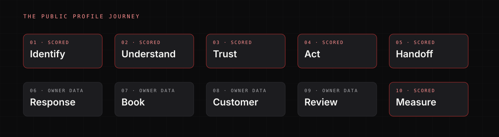

# Framework

The GBP Scorecard follows the customer journey, not the profile's field list.

```text
IDENTIFY → UNDERSTAND → TRUST → ACT → HANDOFF
                                      ↓
                             RESPONSE → BOOK → CUSTOMER → REVIEW
                                      ↓
                                   MEASURE
```

## The ten stages

| # | Stage | Customer question | Coverage |
|---:|---|---|---|
| 1 | Identify | Is this the right business, in the right place? | Scored |
| 2 | Understand | Do I understand the services, fit, hours, and location? | Scored |
| 3 | Trust | Does reputation and content give me enough confidence? | Scored |
| 4 | Act | Can I call, visit, book, or message without friction? | Scored |
| 5 | Handoff | Does the journey stay coherent when I leave Google? | Scored |
| 6 | Response | What happens after I call or message, and how fast? | Owner data required |
| 7 | Book | Does a booking request become a scheduled job? | Owner data required |
| 8 | Customer | Which profile-origin customers became jobs? | Owner data required |
| 9 | Review | Does every completed job feed a consistent review process? | Owner data required |
| 10 | Measure | Can profile-origin activity be distinguished? | Scored |

The public profile can score stages 1–5 and 10. It can only ask about stages 6–9.



## Seven categories

The journey is scored through seven weighted categories:

| Category | Weight |
|---|---:|
| A. Identity & Accuracy | 15 |
| B. Relevance & Service Coverage | 18 |
| C. Conversion & Actionability | 22 |
| D. Reputation & Trust | 20 |
| E. Content & Freshness | 10 |
| F. Handoff & Journey Continuity | 10 |
| G. Measurement & Attribution | 5 |
| **Total** | **100** |

Conversion receives the highest weight because the profile's main job is to produce a next step. Content and measurement matter, but they do not outrank the action path.

## Evidence model

Every check ends in one state:

- **VERIFIED** — directly observed or safely measured.
- **STRONG SIGNAL** — the observation is real, but the consequence is not proven.
- **OWNER DATA REQUIRED** — needs CRM, call, messaging, scheduling, or financial data.
- **NOT APPLICABLE** — does not reasonably apply.

Owner-data questions are never scored. Optional opportunities are never scored. See [Evidence](evidence.md).

## Applicability

Not every trade has the same journey. A service-area plumber should not be penalized for a missing retail storefront. A painter should not be penalized for not offering emergency service. Configuration determines applicability:

```json
{
  "trade": "plumbing",
  "service_business": true,
  "emergency_service": true,
  "physical_storefront": false,
  "online_booking_expected": true,
  "messaging_expected": false,
  "after_hours_expected": true,
  "content_posts_expected": false
}
```

When a conditional check is disabled, it is N/A and removed from the denominator. When an action does not exist to inspect, a downstream handoff or attribution check is also N/A, so the same missing action is not penalized twice. See [Configuration](configuration.md).

## Opportunity flags

Financing, memberships, maintenance plans, SMS, AI reception, online estimates, review automation, missed-call recovery, advanced attribution, video, and enhanced content cadence are **not scored**.

They are reported as opportunities when the evidence supports them. An optional RAD service is never the reason a business loses points.

## What is deliberately excluded

- Local Pack rank, grid visibility, organic ranking, AI answer inclusion — [Local Visibility Scorecard](https://thatguynef.github.io/local-visibility-scorecard/).
- Website form usability, page speed, mobile layout, on-site analytics — [Website Scorecard](https://thatguynef.github.io/website-scorecard/).
- Call answer rate, speed-to-lead, booking conversion, close rate, revenue — owner data or authorized connected diagnostics.
- Competitor benchmarking with invented market data.
- Reviews or business facts that were not observed.

## Canonical source

The machine-readable rubric is `.opencode/skills/home-service-gbp-audit/references/rubric.json`. It contains 49 checks, each with an ID, category, weight, journey stage, evidence types, evaluation method, applicability, severity, anchors, and recommended intervention.

Generated artifacts:

- [`rubric.md`](rubric.md)
- `coverage-matrix.json`
- `portable-checklist.md`

Do not hand-edit generated files.
