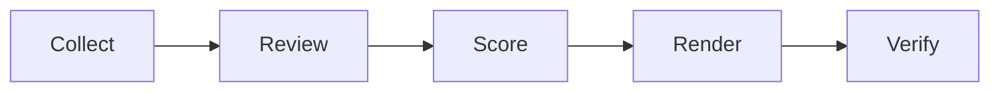

---
hide:
  - navigation
  - toc
---

<section class="gbp-hero">
  <div>
    <p class="gbp-eyebrow">FOR LOCAL HOME-SERVICE BUSINESSES</p>
    <h1>Find where your Google Business Profile may be leaking local customers.</h1>
    <p class="gbp-lede">GBP Scorecard scores what the public profile can prove, separates verified profile leaks from owner-data questions, and produces a contractor-facing report in one run.</p>
    <div class="gbp-actions">
      <a class="gbp-btn gbp-btn--primary" href="run-an-audit/">Run an audit</a>
      <a class="gbp-btn" href="audience/">Who it's for</a>
      <a class="gbp-btn" href="framework/">See the framework</a>
    </div>
    <p class="gbp-trades">Plumbing · HVAC · Roofing · Electrical · Pest control · Garage door · Landscaping · Restoration · Cleaning</p>
  </div>
  <figure class="gbp-hero__media">
    
    <figcaption>Synthetic sample report</figcaption>
  </figure>
</section>

## What you get

<div class="grid cards gbp-cards-4" markdown>

-   :material-map-marker-radius:{ .lg .middle } **A profile score you can defend**

    ---

    A 0–100 score across seven weighted categories. Conversion receives the highest weight because a profile's job is to produce a next step. N/A checks leave the denominator.

-   :material-file-document-outline:{ .lg .middle } **A report a contractor will read**

    ---

    Three findings, the evidence behind each, the fix, and the questions only the owner can answer.

-   :material-magnify-scan:{ .lg .middle } **Evidence states, not opinions**

    ---

    VERIFIED, STRONG SIGNAL, OWNER DATA REQUIRED, or NOT APPLICABLE. Every finding is labeled.

-   :material-database-outline:{ .lg .middle } **Machine-readable output**

    ---

    `audit.json`, `scores.json`, a coverage matrix, and a verification gate for future RAD ingestion.

</div>

## How it works



Collection is deterministic and read-only. Only judgment checks use a model. Scoring, rendering, and verification are file-based and reproducible. Read the [architecture](architecture.md) if you want the details.

The score answers:

> How effectively does the observable Google Business Profile support a local customer's journey from discovery to meaningful action?

It does not answer:

> How completely was every Google field populated?

## What this is not

It is not a completeness grader, a SaaS dashboard, a GBP management product, or the Website Scorecard with Google checks added.

It is not a revenue guarantee. A public profile can show a missing action, a stale review surface, or a broken handoff. It cannot prove that a business lost a specific job unless authorized operational data is supplied and handled separately.

## Start here

<div class="grid cards" markdown>

-   **I own or market a home-service business**

    ---

    Start with [who this is for](audience.md) and [why this exists](why-this-exists.md).

-   **I want to run an audit**

    ---

    Use the synthetic fixture first, then a configured public audit. See [Run an audit](run-an-audit.md).

-   **I want to extend the rubric**

    ---

    Read [Architecture](architecture.md), [Evidence](evidence.md), and [Scoring](scoring.md) before adding a check.

</div>

## A coordinated scorecard family

```text
LOCAL VISIBILITY
      ↓
GBP SCORECARD
      ↓
WEBSITE SCORECARD
      ↓
RAD
```

GBP Scorecard diagnoses the public profile. [Website Scorecard](https://thatguynef.github.io/website-scorecard/) diagnoses the owned site. Local Visibility Scorecard will diagnose discovery. The boundaries are explicit in [The Scorecard Family](scorecard-family.md).

> [!NOTE]
> Every public example is synthetic or sanitized. The repository never ships real client screenshots, reports, customer data, or connected-account data. The Scorecard diagnoses; remediation is a separate system.

GBP Scorecard is maintained alongside [Radical Red Rocket](https://radicalredrocket.com), which uses it as a diagnostic framework behind local visibility and revenue-leak work.
